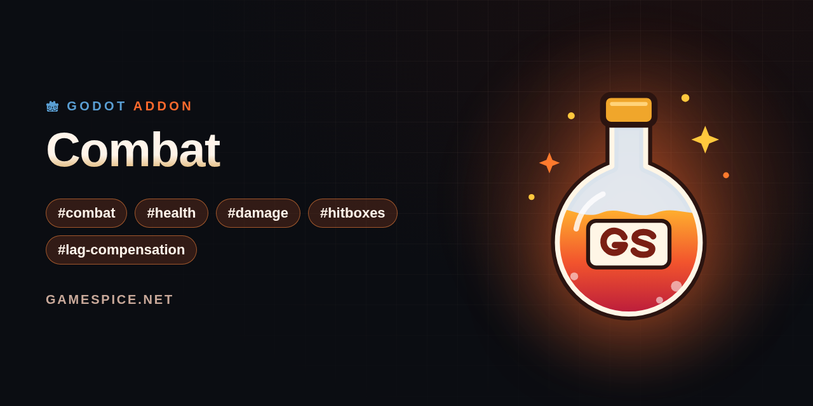

[](https://moddingcommunity.com/a/25-gs-combat)

Health, damage and hit registration for a Godot 4.7+ shooter. It gives you hitboxes, scatter that is the same everywhere, lag compensation, and a resolver that turns a shot into damage under one set of rules. A client can predict its own fire while the server stays the authority. Part of the [GameSpice](https://github.com/gamespice-platform) family.

GameSpice Combat is an MIT licensed GameSpice addon, built with Claude Code, with a headless self-test at `res://examples/combat_selftest.tscn`. Damage and hit registration in the games of [Zee's Games](https://zeesgames.com) go through it, on live servers.

It needs [GameSpice Core](https://github.com/gamespice-platform/core). It works with GameSpice Net, [GameSpice Weapon](https://github.com/gamespice-platform/weapon) and GameSpice Player Controller without importing any of them. It does not know what a weapon is: a `GSShot` describes itself (damage, range, splash), so a rifle, a bow, a thrown charge, a trap or a hazard all produce one the same way.

## Install

1. Copy `addons/gs_combat/` and `addons/gs_core/` into your project.
2. Enable both in *Project > Project Settings > Plugins*.

## Quick start

```gdscript
# Once, on the server.
var combat := GSCombatManager.new()
combat.trace = GSTracePhysics.for_world(get_world_3d())
combat.rules = GSDamageRules.strict()
add_child(combat)

# Per shootable entity.
hitbox_set.register_with(combat, player_id)
combat.register_health(player_id, health)

# Per shot. Anything can build one; gs-weapon usually does.
var shot := GSShot.make(&"rifle", player_id, tick, index)
shot.origin = eye_position
shot.direction = aim
shot.damage = 25.0
shot.max_range = 200.0
shot.scatter()

if is_server:
    combat.resolve_shot(shot, client_view_tick)
```

Something else decides that a shot happened. gs-combat decides what it hit. `resolve_shot()` runs only where the game is authoritative, because a client that resolved its own shots would decide who dies.

## What is in it

| Class | What it does |
| --- | --- |
| `GSHealth` | Health, armour, regeneration and spawn protection, counted in ticks so it replays. |
| `GSDamage` | One damage event, carrying its own scaling trace so a surprising number can be explained. |
| `GSDamageType` | Falloff, armour share, self and friendly scales. A game adds its own. |
| `GSHitGroup` | Named regions and their multipliers. A table, not an enum. |
| `GSHitbox`, `GSHitboxSet` | Capsules, boxes and spheres tested analytically against a ray. |
| `GSTrace` | Where a shot goes. `GSTracePhysics` for a real world, `GSTraceFlat` for a headless one. |
| `GSShot` | One thing that was fired. |
| `GSSpread` | Deterministic scatter, the reason prediction works. |
| `GSDamageRules`, `GSDamageResolver` | Friendly fire, self damage, hit groups, criticals, falloff and clamping, in one order. |
| `GSCombatManager` | Tracing, lag compensation, damage, kill reporting. |
| `GSCombatNetSync` | What to replicate, without naming a GameSpice Net type. |

## Three failures it is built around

| Failure | How it is avoided |
| --- | --- |
| A shot that disagrees with itself. | Spread from a random stream differs on the predicting client, the server and every replay. `GSSpread` is a pure function of shooter, tick, shot and pellet, so all agree. |
| A shot through a wall. | World geometry and hitboxes are traced together, and a tie between a hitbox and a wall goes to the wall. |
| A rewind that leaks. | Lag compensation moves hitboxes into the past. Every path out of `resolve_shot()`, including refusals, restores them. |

## Lag compensation

GameSpice Combat does not name GameSpice Net. Two callables turn compensation on:

```gdscript
combat.rewind_fn = func(view_tick: float) -> void:
    net.history.rewind(view_tick, net.registry.all())
combat.restore_fn = net.history.restore
```

Unset, shots resolve against the present. That is right for a listen server and wrong for anyone with latency.

More: [docs/design.md](docs/design.md).

## Test

```bash
godot --headless --path . --import
godot --headless --path . res://examples/combat_selftest.tscn
```

The self-test is offline and exits non-zero on any failure.

## Used by

### Zee's Games

Zee's Games is a collection of games I made on GameSpice, for demonstration and for fun. They show what the platform can do, and they run on live servers you can join. Anybody can create games on GameSpice, and each addon is its own repository and can be used separately from the games and from the rest of GameSpice.

Every game in the collection vendors it:

- [Fatal Contact](https://zeesgames.com/fatal-contact)
- [Airdrift](https://zeesgames.com/airdrift)
- [Playlot](https://zeesgames.com/playlot)
- [Hungario](https://zeesgames.com/hungario)
- [Buses From Hell](https://zeesgames.com/buses-from-hell)
- [Smash Copter](https://zeesgames.com/smash-copter)
- [Zombie Zone](https://zeesgames.com/zombie-zone)
- [Hide n Seek](https://zeesgames.com/hide-n-seek)
- [Prop Hunt](https://zeesgames.com/prop-hunt)
- [Murder Mystery](https://zeesgames.com/murder-mystery)
- [Deathrun](https://zeesgames.com/deathrun)
- [Wipeout](https://zeesgames.com/wipeout)
- [Dangerous Delivery](https://zeesgames.com/dangerous-delivery)
- [Look At Me](https://zeesgames.com/look-at-me)

The whole collection is at [zeesgames.com](https://zeesgames.com).

## Licence

MIT. See [LICENSE](LICENSE). Only the TMC back-end web infrastructure is not open source.
